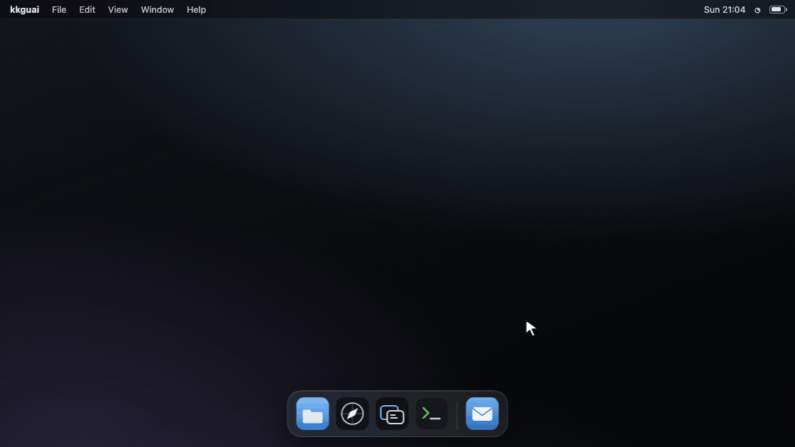

<div align="center">

<a href="https://github.com/kkguai666/kkguai/releases/latest"></a>

# kkguai

**把 Windows 程序，变成 Mac 原生窗口。**<br>
不用虚拟机，不用整块远程桌面，也不用再买 Parallels。

[中文](#中文) · [English](#english) · [官网 / Website](https://kkguai666.github.io/kkguai/) · [Releases](https://github.com/kkguai666/kkguai/releases/latest)


</div>

---

## 中文

### 这是什么

kkguai 是一款面向 macOS 的开源 RemoteApp 客户端。它连接你已有的 Windows 电脑，把**单个程序**变成 Mac 上真正的窗口：自己的标题栏、自己的 Dock 图标、自己的 ⌘Tab 条目。

程序仍然运行在那台 Windows 电脑上；Mac 只负责显示窗口和发送键盘、鼠标。你不需要在 Mac 里装 Windows，不需要虚拟机，也不需要开着一整块远程桌面。

> 你已经有 Windows 电脑了。现在它的程序可以像 Mac 应用一样用。

### 为什么是 kkguai

- **像本地应用，而不是远程桌面。** 没有「一个大窗口里装着另一台电脑」。每个程序就是一个窗口，拖到哪、放多大，都和你 Mac 上的其他应用一样。
- **Retina 和中文输入法都做对了。** 会话按 200% 协商、2 倍像素渲染；拼音在 Mac 上合成，候选框在 Mac 上弹，选好的字直接落进远端程序。
- **免费、开源、小到可以读完。** Swift + FreeRDP，MIT 许可。不用订阅，不用买 Windows 授权，用你已有的那台机器。

### 它做了哪些细节

| | |
|---|---|
| 单窗口 RemoteApp | 远端程序一个窗口 = Mac 一个原生窗口，不显示远端桌面 |
| Retina / HiDPI | 200% 会话协商，1/2 点坐标映射，2× 渲染 |
| Mac 输入法 | 中文、日文、韩文在 Mac 合成，以 Unicode 发送，不会二次合成 |
| 远端光标 | 光标形状与热点跟随 Windows，点击位置所见即所得 |
| 本地拖拽 | 移动、缩放在 Mac 本地完成，松手后同步给远端 |
| Dock 与启动 | 每个远端程序独立 Dock 图标；Windows 11 风格开始菜单；支持 Spotlight / Launchpad |
| 多显示器 | Mac 显示器布局同步给远端，窗口可跨屏拖动 |
| 快捷键 | Mac 键盘直通，左 Command 映射为 Ctrl，常用快捷键符合 Mac 习惯 |
| 桌面模式 | 需要时也能把整个 Windows 桌面放进一个 Mac 窗口 |

### 和常见方案比一比

| | kkguai | Parallels Desktop | 微软 Windows App | UTM |
|---|---|---|---|---|
| 每个程序一个原生窗口 | **✓** | ✓（Coherence） | ✗ 只有整块桌面 | ✗ |
| 需要虚拟机 | **不用** | 需要 | 不用 | 需要 |
| 需要 Windows 授权 | **用你已有的那台** | 需要 | 需要（专业版） | 需要 |
| Retina 清晰渲染 | ✓ | ✓ | ✓ | ✓ |
| 中文输入法 | ✓ | ✓ | ✓ | ✓ |
| 价格 | **免费** | $99/年起 | 免费 | 免费 |
| 开源 | **MIT** | ✗ | ✗ | Apache-2.0 |

<sub>截至 2026 年 11 月。Parallels Desktop 的价格不含 Windows 授权；作为 RDP 主机需要 Windows 专业版。</sub>

### 安装

#### 1. 在 Windows 上打开远程桌面

需要 Windows 10 / 11 **专业版**（家庭版不能作为 RDP 主机）。在管理员 PowerShell 中运行：

```powershell
Set-ItemProperty 'HKLM:\System\CurrentControlSet\Control\Terminal Server' -Name fDenyTSConnections -Value 0
Enable-NetFirewallRule -Group '@FirewallAPI.dll,-28752'
```

然后导入 Release 附件里的 **`enable-remoteapp.reg`**（管理员权限，必需）和可选的 `single-session.reg`，重启 Windows。前者允许未注册为 RemoteApp 的程序以 Mac 窗口运行；不导入的话，程序可能起不来。

两台机器需要在同一网络，或通过 VPN / Tailscale 互通。

#### 2. 在 Mac 上安装

要求 macOS 14 或更高、Apple Silicon。

1. 从 [Releases](https://github.com/kkguai666/kkguai/releases/latest) 下载最新的 `.dmg`。
2. 打开 DMG，把 `kkguai.app` 拖进「应用程序」。
3. 发布包尚未经过 Apple 公证，首次打开前执行一次：

   ```bash
   xattr -dr com.apple.quarantine /Applications/kkguai.app
   ```

   然后正常打开即可。

#### 3. 连接

填写 Windows 电脑的地址和账号，连接后从开始菜单打开程序。每个程序都会有自己的 Mac 窗口和 Dock 图标。

### 常见问题

<details>
<summary><b>Windows 电脑要一直开着吗？</b></summary>
<br>要。程序本身运行在那台机器上，kkguai 只负责显示窗口和发送输入。那台电脑休眠或断网，窗口就会消失。
</details>

<details>
<summary><b>不在同一个局域网能用吗？</b></summary>
<br>能。VPN、Tailscale、端口转发都可以。建议用 VPN 或 Tailscale，不要把 3389 直接暴露在公网。
</details>

<details>
<summary><b>为什么首次打开要执行 xattr？</b></summary>
<br>发布包是 ad-hoc 签名，还没有经过 Apple 公证，所以下载后 macOS 会隔离它。去掉隔离标记只需要一条命令，每次安装做一次。
</details>

<details>
<summary><b>和 Parallels 有什么区别？</b></summary>
<br>Parallels 在 Mac 里跑一整台 Windows 虚拟机，要买它的订阅，还要 Windows 授权；kkguai 用你已有的 Windows 电脑，不花钱，也不占 Mac 的内存和 CPU。代价是那台电脑必须在线、网络可达。
</details>

<details>
<summary><b>Intel Mac 能用吗？</b></summary>
<br>当前发布包只支持 Apple Silicon。Intel Mac 可以从源码构建，见下面的构建说明。
</details>

<details>
<summary><b>怎么反馈问题或提需求？</b></summary>
<br>菜单栏 <code>kkguai → Send Feedback…</code>（피드백 보내기）直接写给我，可以留邮箱方便回复；反馈会自动带上 app 版本、macOS 版本和界面语言。也可以开 [issue](https://github.com/kkguai666/kkguai/issues)。
</details>

还有问题？看 [排障手册](docs/troubleshooting.md)，或开一个 [issue](https://github.com/kkguai666/kkguai/issues)。

### 从源码构建

需要 Xcode Command Line Tools（Swift 5.9+）。

```bash
git clone https://github.com/kkguai666/kkguai.git
cd kkguai
./scripts/build-app.sh                # 构建并安装到 /Applications/kkguai.app
./scripts/build-app.sh --no-install   # 只构建到 build/kkguai.app
```

首次构建会自动调用 `scripts/build-freerdp.sh`，在 `build/deps/` 下编译 FreeRDP 和 OpenSSL。

### 致谢

kkguai 基于 [Pstsc](https://github.com/D-opamin-e/pstsc)（MIT）修改而来，感谢原作者的工作。底层使用 [FreeRDP](https://github.com/FreeRDP/FreeRDP)。

---

## English

**Website:** [English](https://kkguai666.github.io/kkguai/en/) · [中文](https://kkguai666.github.io/kkguai/) · [Releases](https://github.com/kkguai666/kkguai/releases/latest)

### What it is

kkguai is an open-source RemoteApp client for macOS. It connects to the Windows PC you already own and turns **individual programs** into real Mac windows: their own title bar, their own Dock icon, their own ⌘Tab entry.

The programs still run on that Windows PC; the Mac only displays their windows and sends keyboard and mouse input. There is no Windows install on the Mac, no virtual machine, and no full-screen remote desktop.

> You already own a Windows PC. Now its apps can work like Mac apps.

### Why kkguai

- **Like a local app, not a remote desktop.** There is no "one big window with another computer inside it". Each program is a window — move it, resize it, put it next to your Mac apps.
- **Retina and CJK input done properly.** The session is negotiated at 200% scaling with 2× rendering; Pinyin is composed on the Mac, the candidate window appears on the Mac, and finished characters land in the remote app.
- **Free, open source, small enough to read.** Swift + FreeRDP, MIT licensed. No subscription, no Windows licence purchase — just the machine you already have.

### What's implemented

| | |
|---|---|
| Per-app RemoteApp | One remote program = one native Mac window; the remote desktop is never shown |
| Retina / HiDPI | 200% session scaling, 1/2-point coordinate mapping, 2× rendering |
| Mac input method | Chinese, Japanese and Korean composed on the Mac, sent as Unicode, never composed twice |
| Remote cursors | Windows cursor shapes and hotspots; clicks land where the cursor says |
| Local drag and resize | Moves and resizes happen on the Mac and sync to the server on mouse-up |
| Dock and launching | A Dock icon per remote app; Windows 11-style Start menu; Spotlight / Launchpad support |
| Multi-monitor | The Mac display layout is mirrored to the session; windows can move across screens |
| Keyboard | Mac keys pass through; left Command acts as Ctrl; familiar shortcuts keep working |
| Desktop mode | Optionally show the whole Windows desktop in a single Mac window |

### How it compares

| | kkguai | Parallels Desktop | Microsoft Windows App | UTM |
|---|---|---|---|---|
| One native window per app | **✓** | ✓ (Coherence) | ✗ full desktop only | ✗ |
| Virtual machine required | **No** | Yes | No | Yes |
| Windows licence required | **Your existing PC** | Yes | Yes (Pro for hosting) | Yes |
| Retina rendering | ✓ | ✓ | ✓ | ✓ |
| Chinese input method | ✓ | ✓ | ✓ | ✓ |
| Price | **Free** | From $99/year | Free | Free |
| Open source | **MIT** | ✗ | ✗ | Apache-2.0 |

<sub>As of November 2026. The Parallels Desktop price does not include a Windows licence; hosting RDP requires Windows Pro.</sub>

### Install

#### 1. Enable Remote Desktop on Windows

You need Windows 10 / 11 **Pro** (Home cannot host RDP). Run this in an administrator PowerShell:

```powershell
Set-ItemProperty 'HKLM:\System\CurrentControlSet\Control\Terminal Server' -Name fDenyTSConnections -Value 0
Enable-NetFirewallRule -Group '@FirewallAPI.dll,-28752'
```

Then import **`enable-remoteapp.reg`** from the release as administrator (required), and optionally `single-session.reg`, and reboot Windows. The first file allows programs that are not registered as RemoteApps to run as Mac windows; without it, programs may not start.

The two machines must be on the same network, or reachable through a VPN / Tailscale.

#### 2. Install on the Mac

Requires macOS 14 or later, Apple Silicon.

1. Download the latest `.dmg` from [Releases](https://github.com/kkguai666/kkguai/releases/latest).
2. Open the DMG and drag `kkguai.app` into Applications.
3. The build is not notarized by Apple yet. Before the first launch, run once:

   ```bash
   xattr -dr com.apple.quarantine /Applications/kkguai.app
   ```

   Then open it normally.

#### 3. Connect

Enter the Windows PC's address and account, then open apps from the Start menu. Each one gets its own Mac window and Dock icon.

### FAQ

<details>
<summary><b>Does the Windows PC have to stay on?</b></summary>
<br>Yes. The programs run on that machine; kkguai only displays their windows and sends input. If the PC sleeps or loses the network, the windows disappear.
</details>

<details>
<summary><b>Can I use it outside my LAN?</b></summary>
<br>Yes. VPN, Tailscale and port forwarding all work. Use a VPN or Tailscale rather than exposing port 3389 directly to the internet.
</details>

<details>
<summary><b>Why the xattr command on first launch?</b></summary>
<br>The release is ad-hoc signed but not notarized by Apple, so macOS quarantines it after download. Removing the quarantine flag takes one command, once per install.
</details>

<details>
<summary><b>How is this different from Parallels?</b></summary>
<br>Parallels runs a whole Windows virtual machine on your Mac and needs its own subscription plus a Windows licence. kkguai uses a Windows PC you already own, so it costs nothing and doesn't take RAM or CPU from the Mac. The trade-off: that PC must be online and reachable.
</details>

<details>
<summary><b>Does it work on Intel Macs?</b></summary>
<br>The current release is Apple Silicon only. Intel Macs can build from source — see the build section below.
</details>

<details>
<summary><b>How do I report a problem or ask for a feature?</b></summary>
<br>Use <code>kkguai → Send Feedback…</code> in the menu bar. An email address is optional if you want a reply; the app adds its version, your macOS version and the interface language. GitHub [issues](https://github.com/kkguai666/kkguai/issues) work too.
</details>

Still stuck? Read the [troubleshooting guide](docs/troubleshooting.md) or open an [issue](https://github.com/kkguai666/kkguai/issues).

### Build from source

Xcode Command Line Tools (Swift 5.9+) required.

```bash
git clone https://github.com/kkguai666/kkguai.git
cd kkguai
./scripts/build-app.sh                # build and install to /Applications/kkguai.app
./scripts/build-app.sh --no-install   # build only, into build/kkguai.app
```

The first build runs `scripts/build-freerdp.sh`, which compiles FreeRDP and OpenSSL into `build/deps/`.

### Credits

kkguai is based on [Pstsc](https://github.com/D-opamin-e/pstsc) (MIT) — thanks to its authors. It uses [FreeRDP](https://github.com/FreeRDP/FreeRDP) underneath.

---

## License

[MIT](LICENSE)

---

<div align="center">
<sub>如果它帮你省下了一个 Parallels 订阅，给个 ⭐ 就是最好的回报。<br>If it saves you a Parallels subscription, a star is the best way to say thanks.</sub>
</div>
