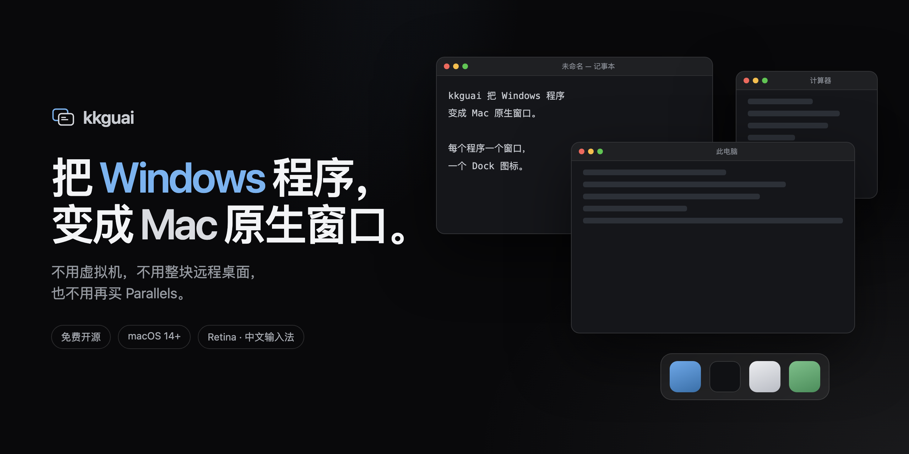

<div align="center">

<a href="https://github.com/kkguai666/kkguai/releases/latest"></a>

# kkguai

**把 Windows 程序，变成 Mac 原生窗口。**<br>
不用虚拟机，不用整块远程桌面，也不用再买 Parallels。

[下载](#安装) · [官网](https://kkguai666.github.io/kkguai/) · [为什么](#为什么是-kkguai) · [对比](#和常见方案比一比) · [English](#english)


</div>

---

## 这是什么

kkguai 是一款面向 macOS 的开源 RemoteApp 客户端。它连接你已有的 Windows 电脑，把**单个程序**变成 Mac 上真正的窗口：自己的标题栏、自己的 Dock 图标、自己的 ⌘Tab 条目。

程序仍然运行在那台 Windows 电脑上；Mac 只负责显示窗口和发送键盘、鼠标。你不需要在 Mac 里装 Windows，不需要虚拟机，也不需要开着一整块远程桌面。

> 你已经有 Windows 电脑了。现在它的程序可以像 Mac 应用一样用。

## 为什么是 kkguai

- **像本地应用，而不是远程桌面。** 没有「一个大窗口里装着另一台电脑」。每个程序就是一个窗口，拖到哪、放多大，都和你 Mac 上的其他应用一样。
- **Retina 和中文输入法都做对了。** 会话按 200% 协商、2 倍像素渲染；拼音在 Mac 上合成，候选框在 Mac 上弹，选好的字直接落进远端程序。
- **免费、开源、小到可以读完。** Swift + FreeRDP，MIT 许可。不用订阅，不用买 Windows 授权，用你已有的那台机器。

## 它做了哪些细节

| | |
|---|---|
| 单窗口 RemoteApp | 远端程序一个窗口 = Mac 一个原生窗口，不显示远端桌面 |
| Retina / HiDPI | 200% 会话协商，1/2 点坐标映射，2× 渲染 |
| Mac 输入法 | 中文、日文、韩文在 Mac 合成，以 Unicode 发送，不会二次合成 |
| 远端光标 | 光标形状与热点跟随 Windows，点击位置所见即所得 |
| 本地拖拽 | 移动、缩放在 Mac 本地完成，松手后同步给远端 |
| Dock 与启动 | 每个远端程序独立 Dock 图标；Windows 11 风格开始菜单；支持 Spotlight / Launchpad |
| 多显示器 | Mac 显示器布局同步给远端，窗口可跨屏拖动 |
| 快捷键 | Mac 键盘直通，左 Command 映射为 Ctrl，常用快捷键符合 Mac 习惯 |
| 桌面模式 | 需要时也能把整个 Windows 桌面放进一个 Mac 窗口 |

## 和常见方案比一比

| | kkguai | Parallels Desktop | 微软 Windows App | UTM |
|---|---|---|---|---|
| 每个程序一个原生窗口 | **✓** | ✓（Coherence） | ✗ 只有整块桌面 | ✗ |
| 需要虚拟机 | **不用** | 需要 | 不用 | 需要 |
| 需要 Windows 授权 | **用你已有的那台** | 需要 | 需要（专业版） | 需要 |
| Retina 清晰渲染 | ✓ | ✓ | ✓ | ✓ |
| 中文输入法 | ✓ | ✓ | ✓ | ✓ |
| 价格 | **免费** | $99/年起 | 免费 | 免费 |
| 开源 | **MIT** | ✗ | ✗ | Apache-2.0 |

<sub>截至 2026 年 11 月。Parallels Desktop 的价格不含 Windows 授权；作为 RDP 主机需要 Windows 专业版。</sub>

## 安装

### 1. 在 Windows 上打开远程桌面

需要 Windows 10 / 11 **专业版**（家庭版不能作为 RDP 主机）。在管理员 PowerShell 中运行：

```powershell
Set-ItemProperty 'HKLM:\System\CurrentControlSet\Control\Terminal Server' -Name fDenyTSConnections -Value 0
Enable-NetFirewallRule -Group '@FirewallAPI.dll,-28752'
```

两台机器需要在同一网络，或通过 VPN / Tailscale 互通。

### 2. 在 Mac 上安装

要求 macOS 14 或更高、Apple Silicon。

1. 从 [Releases](https://github.com/kkguai666/kkguai/releases/latest) 下载最新的 `.dmg`。
2. 打开 DMG，把 `kkguai.app` 拖进「应用程序」。
3. 发布包尚未经过 Apple 公证，首次打开前执行一次：

   ```bash
   xattr -dr com.apple.quarantine /Applications/kkguai.app
   ```

   然后正常打开即可。

### 3. 连接

填写 Windows 电脑的地址和账号，连接后从开始菜单打开程序。每个程序都会有自己的 Mac 窗口和 Dock 图标。

## 常见问题

<details>
<summary><b>Windows 电脑要一直开着吗？</b></summary>
<br>要。程序本身运行在那台机器上，kkguai 只负责显示窗口和发送输入。那台电脑休眠或断网，窗口就会消失。
</details>

<details>
<summary><b>不在同一个局域网能用吗？</b></summary>
<br>能。VPN、Tailscale、端口转发都可以。建议用 VPN 或 Tailscale，不要把 3389 直接暴露在公网。
</details>

<details>
<summary><b>为什么首次打开要执行 xattr？</b></summary>
<br>发布包是 ad-hoc 签名，还没有经过 Apple 公证，所以下载后 macOS 会隔离它。去掉隔离标记只需要一条命令，每次安装做一次。
</details>

<details>
<summary><b>和 Parallels 有什么区别？</b></summary>
<br>Parallels 在 Mac 里跑一整台 Windows 虚拟机，要买它的订阅，还要 Windows 授权；kkguai 用你已有的 Windows 电脑，不花钱，也不占 Mac 的内存和 CPU。代价是那台电脑必须在线、网络可达。
</details>

<details>
<summary><b>Intel Mac 能用吗？</b></summary>
<br>当前发布包只支持 Apple Silicon。Intel Mac 可以从源码构建，见下面的构建说明。
</details>

## 从源码构建

需要 Xcode Command Line Tools（Swift 5.9+）。

```bash
git clone https://github.com/kkguai666/kkguai.git
cd kkguai
./scripts/build-app.sh            # 构建并安装到 /Applications/kkguai.app
./scripts/build-app.sh --no-install   # 只构建到 build/kkguai.app
```

首次构建会自动调用 `scripts/build-freerdp.sh`，在 `build/deps/` 下编译 FreeRDP 和 OpenSSL。

## English

**Run Windows apps as native Mac windows — without a VM and without a full remote desktop.**

kkguai is an open-source RemoteApp (RDP) client for macOS. It connects to the Windows PC you already own and pulls over only the apps you need: one native Mac window per program, one Dock icon each, with Retina rendering, Mac input methods, remote cursors, local window dragging and multi-monitor support.

No Parallels subscription, no Windows licence, no virtual machine.

**Why it exists:** remote desktop tools squeeze an entire Windows screen into one Mac window. kkguai does the opposite — it asks Windows for a single app and gives that app a real Mac window.

**Requirements:** macOS 14+ on Apple Silicon; a Windows 10/11 Pro PC with Remote Desktop enabled; network reachability (LAN, VPN or Tailscale).

**Install:** download the latest `.dmg` from [Releases](https://github.com/kkguai666/kkguai/releases/latest), drag `kkguai.app` into Applications, then run `xattr -dr com.apple.quarantine /Applications/kkguai.app` once (the build is not notarized yet).

**Build from source:** `./scripts/build-app.sh` after cloning; the first build compiles FreeRDP and OpenSSL into `build/deps/`.

## 致谢

kkguai 基于 [Pstsc](https://github.com/D-opamin-e/pstsc)（MIT）修改而来，感谢原作者的工作。底层使用 [FreeRDP](https://github.com/FreeRDP/FreeRDP)。

## License

[MIT](LICENSE)

---

<div align="center">
<sub>如果它帮你省下了一个 Parallels 订阅，给个 ⭐ 就是最好的回报。</sub>
</div>
